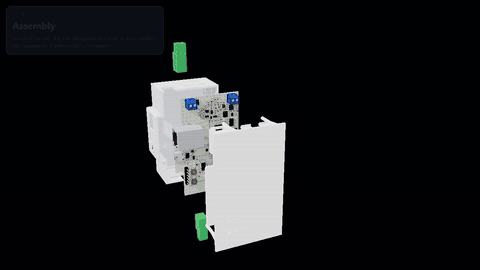
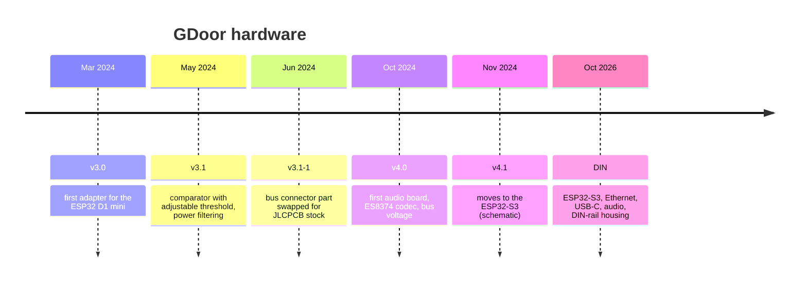

# GDoor

**Open hardware and firmware that connect a Gira door intercom to your smart home.**

Ring the doorbell, get a notification. Press a button in Home Assistant, the door opens.

&nbsp;

Left: the classic adapter (v3.1) &nbsp;·&nbsp; Right: the new DIN-rail board

---

## ✨ What it does

GDoor listens to and talks on the two-wire Gira door system bus. It is a DIY alternative to the
Gira TKS-IP-Gateway, built entirely from reverse-engineered findings about the bus.

<table>
<tr>
<td width="50%" valign="top">

### 🔔 Listen
Every bus message arrives in your smart home: doorbell presses, floor calls, the indoor
station picking up. Trigger a phone notification, a chime or a camera snapshot.

</td>
<td width="50%" valign="top">

### 🔓 Send
Put any message on the bus from an automation: open the door, switch the light, call a
station.

</td>
</tr>
<tr>
<td valign="top">

### 🏠 Integrate
[Home Assistant](https://gdoor-org.github.io/documentation/homeassistant.html) and
[openHAB](https://gdoor-org.github.io/documentation/openhab.html) through MQTT, or native
Home Assistant entities through the [ESPHome component](esphome/README.md).

</td>
<td valign="top">

### 🎙️ Talk *(in development)*
Two-way voice from the door station to Home Assistant over VoIP, on the boards with the
ES8374 audio codec. Video is neither supported nor planned.

</td>
</tr>
</table>

---

## 🧭 Two product lines

<table>
<tr>
<th width="50%">🔌 Classic adapter</th>
<th width="50%">🗄️ DIN-rail board</th>
</tr>
<tr>
<td valign="top">

A small shield that plugs onto an off-the-shelf ESP32 board. Cheap, proven, and powered by
the USB port of the ESP32 board.

- Versions **v3.0 → v4.1**
- Tagged releases with production files in [`hardware/releases/`](hardware/releases/README.md)
- **v3.1 / v3.1-1 is the version to build today**

</td>
<td valign="top">

One board with everything soldered on, in a 2-module (35 mm) DIN-rail housing that sits in
the distribution cabinet next to the intercom power supply.

- ESP32-S3, **wired Ethernet**, USB-C, audio codec
- 3D-printable enclosure, ESPHome configs ready
- **Designed, not built yet** — see [`DESIGN.md`](hardware/boards/din/DESIGN.md)

</td>
</tr>
</table>

---

## 📊 Version comparison

| | **v3.0** | **v3.1** | **v3.1-1** | **v4.0** | **v4.1** | **DIN** |
|---|:---:|:---:|:---:|:---:|:---:|:---:|
| **Status** | 🗄️ superseded | ✅ released | ✅ **recommended** | 🧪 prototype | 🚧 schematic only | 🚧 routed, not built |
| **Released** | Mar 2024 | May 2024 | Jun 2024 | Oct 2024 | — | — |
| **Form factor** | shield | shield | shield | shield | shield | DIN rail, 2 modules |
| **Microcontroller** | ESP32 D1 mini | ESP32 D1 mini | ESP32 D1 mini | ESP32 D1 mini | ESP32-S3 DevKitC‑1 (N8R2) | ESP32-S3-WROOM‑1 (N8R2), on board |
| **Bus receive** | wrong logic levels — needs a [bodge wire](https://github.com/gdoor-org/gdoor/blob/3.0/doc/pcb-modification.png) | LM393, adjustable threshold (DAC) | LM393, adjustable threshold (DAC) | fixed threshold | fixed threshold | fixed threshold |
| **Bus send (door opener)** | ✅ | ✅ | ✅ | ✅ | ✅ | ✅ |
| **Bus voltage measurement** | — | — | — | ✅ ÷9.2 | ✅ | ✅ ÷11, "bus connected" |
| **Audio codec (ES8374)** | — | — | — | ✅ hardware | ✅ hardware | ✅ hardware |
| **Two-way voice** | — | — | — | — | — | 🚧 ESPHome config, untested |
| **Network** | WiFi | WiFi | WiFi | WiFi | WiFi | **Ethernet** (W5500) or WiFi |
| **Ethernet add-on** | W5500 module wired on | W5500 module wired on | W5500 module wired on | ❌ pins taken by codec | — | built in, RJ45 |
| **Power** | ESP32 board USB | ESP32 board USB, filtered | ESP32 board USB, filtered | ESP32 board USB | DevKit USB | USB-C or 5 V terminal |
| **Bus connector** | screw terminal | pluggable terminal | pluggable, part swapped for JLC stock | pluggable terminal | pluggable terminal | pluggable 3.81 mm |
| **Status LEDs** | — | — | — | — | — | 2 |
| **Enclosure** | — | — | — | — | — | 3D-printed, TS35 clip |
| **MQTT firmware** | ✅ (RX on IO12/IO32) | ✅ | ✅ | ✅ bus only | — | ❌ |
| **ESPHome component** | ✅ | ✅ | ✅ | ✅ bus only | — | ✅ Ethernet · WiFi · voice |
| **Files** | [`v3.0/`](hardware/releases/v3.0) | [`v3.1/`](hardware/releases/v3.1) | [`v3.1-1/`](hardware/releases/v3.1-1) | [`v4.0/`](hardware/releases/v4.0) | [`esp32-mini/`](hardware/boards/esp32-mini) | [`din/`](hardware/boards/din) |

✅ supported &nbsp;·&nbsp; 🚧 in progress &nbsp;·&nbsp; 🧪 experimental &nbsp;·&nbsp; ❌ not possible &nbsp;·&nbsp; — not present.
The KiCad sources of each release are at the git tag of the same name (`3.0`, `3.1`, `3.1-1`, `4.0`).
v4.1's layout is still the v4.0 board.

### How the line evolved

---

## 🗄️ The DIN-rail board

Click for the full video · interactive 3D viewer in [`showcase/`](hardware/boards/din/showcase/README.md)

<table>
<tr>
<td width="55%" valign="top">

| | |
|---|---|
| **MCU** | ESP32-S3-WROOM-1-N8R2 (8 MB flash, 2 MB PSRAM) |
| **Network** | W5500 + RJ45 with magnetics, or WiFi |
| **Audio** | ES8374 codec coupled to the bus |
| **Power** | 5 V from USB-C or screw terminal, OR-ed |
| **Front** | RJ45, USB-C, 2 status LEDs |
| **PCB** | 4 layers, 1.6 mm, ~85 × 50 mm |
| **Housing** | 35 mm wide, 90 mm high, TS35 clip |
| **Firmware** | ESPHome: [Ethernet](esphome/gdoor-din-ethernet.yaml) · [WiFi](esphome/gdoor-din-wifi.yaml) · [voice](esphome/gdoor-din-voice.yaml) |

</td>
<td width="45%" valign="top" align="center">

Printable base and lid — [`enclosure/`](hardware/boards/din/enclosure/README.md)

</td>
</tr>
</table>

| Where to look | |
|---|---|
| 📐 Design spec, pin map, open points | [`DESIGN.md`](hardware/boards/din/DESIGN.md) |
| 🏭 JLCPCB gerbers, BOM, CPL, iBOM | [`production/gdoor_din/`](hardware/boards/din/production/gdoor_din) |
| 📈 SPICE simulation of the bus front end and Ethernet | [`spice/`](hardware/boards/din/spice/README.md) |
| 🧊 Enclosure (OpenSCAD, STL, STEP) | [`enclosure/`](hardware/boards/din/enclosure/README.md) |

> [!NOTE]
> The DIN board is routed, DRC-clean and logic-checked, but **no board has been built or tested
> yet**. DIN releases are published from `din-*` git tags as GitHub releases.

---

## 🧩 Software

| | **MQTT firmware** | **ESPHome component** |
|---|---|---|
| **Folder** | [`firmware/`](firmware/README.md) | [`esphome/`](esphome/README.md) |
| **Talks to** | any MQTT broker → Home Assistant, openHAB, Node-RED … | Home Assistant native API |
| **Install** | [web installer](https://gdoor-org.github.io/documentation/firmware.html), no toolchain | your ESPHome YAML, `external_components` |
| **Setup** | web page on the adapter, web console for live bus traffic | YAML; learning mode logs the bus |
| **Boards** | classic adapter v3.x, v4.0 | classic adapter v3.x, v4.0, DIN board |
| **Extras** | Ethernet via W5500 add-on | Ethernet, other ESPHome components alongside (e.g. Bluetooth proxy), voice on DIN |

Both build the **same bus encoder/decoder**: the ESPHome component carries a copy of
`firmware/src`, kept in sync by `tools/sync_esphome_core.py` and checked in CI.

---

## 📁 Repository layout

| Folder | Contents |
|---|---|
| [`firmware/`](firmware/README.md) | Arduino/PlatformIO firmware (MQTT, web installer, web console) |
| [`esphome/`](esphome/README.md) | ESPHome external component and the DIN board configs |
| [`hardware/`](hardware/README.md) | KiCad boards (`boards/esp32-mini`, `boards/din`), shared library (`lib/`), release files (`releases/`) |
| [`software/bus-debugger/`](software/bus-debugger/README.md) | MQTT bus listener for decoding messages |
| `tools/` | Repository helper scripts |

---

## 🤝 Contributing

GDoor collects and documents what is known about the Gira door system, all figured out by
reverse engineering. Bus captures from installations we have not seen yet, bug reports, and
hardware tests are all welcome — open an issue or a pull request.

Licensed under the [GNU GPL v3](LICENSE) · not affiliated with Gira

