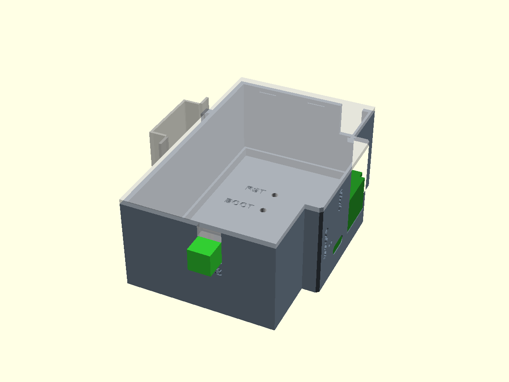

# GDoor DIN enclosure

3D-printable DIN-rail housing for the gdoor-din board: 2 modules (35 mm),
90 mm high, DIN 43880 style front window (45 mm) standing 6 mm proud of the
shoulders, TS35 rail clip. RJ45, USB-C and the two status LEDs face the
front window. The bus connects through a pluggable 3.81 mm terminal on the
top face.



| File | What |
|---|---|
| `enclosure.scad` | the model (OpenSCAD 2021.01) |
| `board_ghost.scad` | board and parts as boxes, generated, for the fit check |
| `board_export.py` | regenerates `board_ghost.scad` from `../esp32.kicad_pcb` |
| `gdoor-din-base.stl`, `gdoor-din-lid.stl` | ready to print |
| `gdoor-din-base.step`, `gdoor-din-lid.step` | the same parts as STEP solids, for other CAD tools |
| `gdoor-din-enclosure.step` | base and lid in their assembled position |
| `step_export.py` | converts the STLs into the STEP files |

## Build the STLs

```
openscad -o gdoor-din-base.stl -D 'part="base"' enclosure.scad
openscad -o gdoor-din-lid.stl  -D 'part="lid"'  enclosure.scad
openscad -o fit.stl            -D 'part="fit"'  enclosure.scad   # must be empty
```

After a layout change run `board_export.py` (KiCad's python, from
`hardware/boards/din`) and the fit check again. The front openings, posts
and button holes are parameters in `enclosure.scad`, not derived from the
board, so they have to be moved by hand if the parts move.

OpenSCAD cannot write STEP, so `step_export.py` converts the STLs: it
sews the triangles into a closed solid and merges flat faces. Round
features stay faceted (`$fn = 40`). It needs OpenCascade's python bindings
(`pip install cadquery-ocp`); run it after the STLs:

```
python step_export.py
```

## Print

PETG preferred: the rail latch is a printed spring. 0.2 mm layers, no
supports. Both parts print flat on their outer side wall; the lid STL is
already flipped.

## Layout

- The board stands on edge, its back side on four rails in the base
  (3.5 mm clearance for untrimmed THT leads), its component side towards
  the lid. Five posts on the lid hold it down at free spots.
- Front window: the board's front tab reaches into it, its edge in a
  0.3 mm groove in the window wall. The RJ45 jack goes through a body-sized
  opening (16.6 x 13.9 mm), and the USB-C receptacle in a stadium opening
  around its shell (9.4 x 3.7 mm, 0.2 mm clearance). Both faces end 0.2 mm
  inside the window face, so the cable overmold stops on the face. There are also two 1.3 mm holes for the LEDs. The LEDs are top-emitting
  on the board, so the holes show their glow, not the LED itself; a short
  piece of clear filament works as a light pipe.
- BOOT and RESET are pressed with a pin through the lid (labelled). The lid
  is covered by the neighbouring module on the rail, so take the device off
  the rail to reach them.
- Rail clip: fixed hook at the top, spring latch at the bottom. Hook the
  top on, press the bottom on. To remove, pry the latch beam down with a
  small screwdriver from below.

## Bus plug

The female half of a 2-pole 3.81 mm pluggable terminal (15EDGK type, e.g.
QUARKZMAN PCB-Klemmleiste) sits in a cradle on the lid. Its mating end
sticks out of the top face above J4; the male cable plug goes on from above.
Its screws face the board, so they are reached with the lid off.

The outer size comes from the listing: female 8 x 11 x 15 mm (`plug_w`,
`plug_h`, `plug_len`); the male cable half is 8 x 11 x 18 mm. The mating
section (`plug_mate_len` 9 mm, `plug_mate_h` 8 mm) is still an estimate:
measure it on the part. The step between the screw
section and the lower mating section rests against the inside of the top
wall and keeps the plug in when the cable is pulled; if your plug has no
such step, glue it into the cradle.

Wiring: two short wires from the plug's screw clamps to the bus pads, J1.
J1's wire entries face the top wall with about 1 mm to spare, so a screw
terminal fitted there cannot take wires inside this housing. Leave J1
unfitted and solder the wires into its holes.

## Assembly

1. Solder the two bus wires into J1's holes.
2. Put the plug in the lid cradle, clamp the wires.
3. Lay the board into the base: back side down onto the rails, front tab
   into the groove in the window wall, so the RJ45 and USB-C come through
   their openings.
4. Close the lid; the plug drops into the slot in the top wall. The rim
   snaps into the base.
